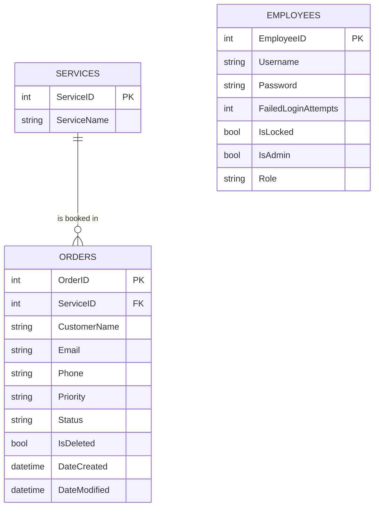

# SkiService        

> SkiService is an order management system for a ski service shop: customers submit service orders online, employees track and update them in a protected dashboard.

> [!NOTE]
> This is a school project for **ÜK Module 295 – "Backend für Applikationen realisieren"** (develop backends for applications), built together with Sebastian. It is finished and works locally, but it is not intended for production use.

- Getting Started
  * [About the Project](#about-the-project)
  * [Features](#features)
  * [Tech Stack](#tech-stack)
  * [Data Model](#data-model)
- Running SkiService
  * [Requirements](#requirements)
  * [Setup](#setup)
  * [Run](#run)
  * [Test Accounts](#test-accounts)
- [API](#api)
- [Project Structure](#project-structure)
- [Known Limitations](#known-limitations)
- [FAQ](#faq)

## About the Project

A ski service shop receives repair and maintenance orders from its customers, for example waxing, binding adjustments or race ski tuning. The goal of this project was to replace manual order handling with a web application backed by a REST API.

Customers use a public web page to choose a service, set a priority and submit their order. Employees log in to a dashboard where they see all open orders and move them through the workflow until they are completed. Administrators have additional rights to delete orders and manage locked employee accounts.

## Features

**Public order form**: customers select a service and a priority (High, Normal, Low) and submit an order with their contact details.

**Employee dashboard**: logged-in employees see all orders and change their status: Open → In Progress → Completed, or Cancelled.

**Authentication and roles**: login with JWT tokens and two roles, `Employee` and `Admin`.

**Admin functions**: soft-delete orders, list all employees and unlock locked accounts.

**API documentation**: every endpoint can be tested in the Swagger UI, including protected endpoints with a Bearer token.

## Tech Stack

| Layer          | Technology                                       |
| -------------- | ------------------------------------------------ |
| Backend        | ASP.NET Core 8 Web API (C#)                      |
| Data access    | Entity Framework Core 8                          |
| Database       | Microsoft SQL Server (Express)                   |
| Authentication | JWT Bearer                                       |
| Frontend       | HTML, JavaScript, Bootstrap, jQuery (`wwwroot`)  |
| API docs       | Swagger (Swashbuckle)                            |

## Data Model

Every order belongs to exactly one service. Orders are never removed from the database; deleting an order only sets the `IsDeleted` flag (soft delete).



## Requirements

- [.NET 8 SDK](https://dotnet.microsoft.com/download/dotnet/8.0)
- Microsoft SQL Server (Express is enough)
- SQL Server Management Studio or another SQL client
- An IDE such as JetBrains Rider or Visual Studio (optional)

## Setup

**1. Clone the repository**

```bash
git clone https://github.com/C3PHEI/Projekt_Modul295.git
cd Projekt_Modul295
```

**2. Create the database**

> [!IMPORTANT]
> The database must exist before the backend is started.

Run the script `Files/SQL Querry/SkiServiceQuerry.txt` in SQL Server. It creates the database `JetstreamServiceDB` with all tables, indexes and sample data.

**3. Adjust the connection string**

Open `appsettings.json` and replace the server name in `DefaultConnection` with your own SQL Server instance:

```json
"DefaultConnection": "Server=YOUR_SERVER\\SQLEXPRESS;Database=JetstreamServiceDB;Trusted_Connection=True;TrustServerCertificate=True;"
```

> [!TIP]
> You can find your instance name in SQL Server Management Studio in the "Connect to Server" dialog.

## Run

```bash
dotnet run --launch-profile https
```

Or start the project in Rider or Visual Studio with the `https` profile.

| What        | URL                              |
| ----------- | -------------------------------- |
| Frontend    | https://localhost:7226           |
| Swagger UI  | https://localhost:7226/swagger   |

## Test Accounts

The SQL script creates the following sample users. The password for all of them is `pass`.

| Username                    | Role     | Note                                   |
| --------------------------- | -------- | -------------------------------------- |
| `admin_user`, `admin_user2` | Admin    |                                        |
| `user1` – `user5`           | Employee |                                        |
| `user6` – `user8`           | Employee | locked, can be unlocked by an admin    |

## API

| Method | Route                              | Access    | Description                          |
| ------ | ---------------------------------- | --------- | ------------------------------------ |
| GET    | `/api/services`                    | public    | List all services                    |
| GET    | `/api/orders`                      | public    | List all orders                      |
| GET    | `/api/orders/{id}`                 | public    | Get a single order                   |
| GET    | `/api/orders/priority/{priority}`  | public    | Filter orders by priority            |
| POST   | `/api/orders`                      | public    | Create a new order                   |
| PUT    | `/api/orders/{id}/status`          | logged in | Change the status of an order        |
| DELETE | `/api/orders/{id}`                 | admin     | Soft-delete an order                 |
| POST   | `/api/auth/login`                  | public    | Log in and receive a JWT token       |
| GET    | `/api/auth/me`                     | logged in | Get the current user                 |
| GET    | `/api/auth/employees`              | admin     | List all employees
